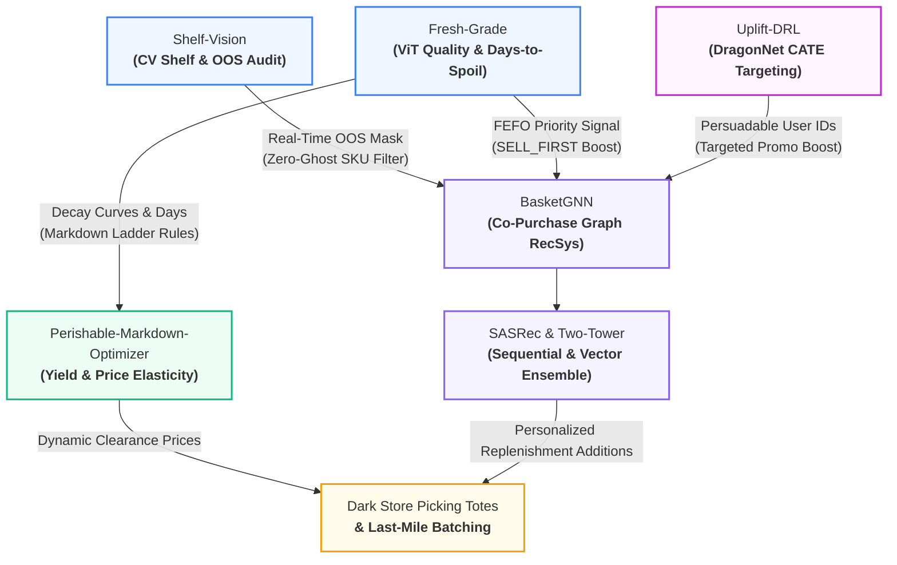

# 👋 Hi, I'm Samir Sandhwar

**Senior Retail Professional & Merchandising Head | Agentic AI & Data Science Engineer | Business Head**  
*Bridging 24+ years of high-volume retail P&L leadership with production autonomous multi-agent AI architectures.*

---

### 🧠 Executive Profile & Foundations

I bring over **24 years of hands-on retail leadership** across E-commerce, Modern Trade, Category Management, and Merchandising Operations, paired with modern technical foundations in **Agentic AI, Recommender Systems, and Applied Machine Learning**. 

My technical architectures are uniquely grounded in a **multidisciplinary foundation**:
* **Autonomous AI & Global Commerce:** Executive Alumnus, **Indian Institute of Foreign Trade (IIFT)**, New Delhi & **IIT Madras Pravartak** (Professional Certificate in Agentic AI and Data Science).
* **Financial & Economic Engineering:** **MBA (Finance)**, Indian Institute of Finance — grounding pricing agents in real-world gross margin thresholds, working capital velocity, and P&L governance.
* **Governance & Legal Guardrails:** **LL.B. (Bachelor of Laws)**, Faculty of Law, University of Delhi — designing hard compliance checks for statutory Maximum Retail Price (MRP) ceilings and contractual vendor agreements.
* **Quantitative First-Principles:** **B.Sc. (Physics)** — mathematical modeling, probability distributions, and price elasticity algorithms.
* **Industry Credentials:** Certified across Artificial Intelligence, Cloud Infrastructure, and Data Engineering by **Google**, **Microsoft**, **IBM**, and **AWS**.

> **Core Value Proposition:** Transitioning retail operations from latency-plagued manual reporting into closed-loop autonomous AI systems that enforce margin guardrails, maximize sales velocity, and drive measurable GMV and inventory turnover improvements.

---

### 🌐 Unified Autonomous Retail AI Mesh: Closed-Loop Operating Architecture

Rather than isolated point solutions, my flagship neural networks and multi-agent systems interconnect into an enterprise closed-loop quick-commerce intelligence pipeline:

* **Zero Ghost-Inventory Recommendations:** [`Shelf-Vision`](https://github.com/findsamirks-commits/Shelf-Vision) identifies empty out-of-stock shelf facings and broadcasts an `OOS mask` to [`BasketGNN`](https://github.com/findsamirks-commits/BasketGNN), ensuring the recsys never recommends unavailable products to shoppers.
* **FEFO Clearance Acceleration:** [`Fresh-Grade`](https://github.com/findsamirks-commits/Fresh-Grade) detects produce ripeness and shelf-life, feeding `SELL_FIRST` priority weights into [`BasketGNN`](https://github.com/findsamirks-commits/BasketGNN) to stimulate sales velocity while simultaneously triggering dynamic yield markdowns in [`Perishable-Markdown-Optimizer`](https://github.com/findsamirks-commits/Perishable-Markdown-Optimizer).
* **Deep Causal Promo Personalization:** [`Uplift-DRL`](https://github.com/findsamirks-commits/Uplift-DRL) estimates Conditional Average Treatment Effect (CATE) using DragonNet with targeted regularization, filtering out "Sure Things" and "Sleeping Dogs" to direct promotional coupon spend exclusively to "Persuadable" shoppers, feeding high-propensity customer IDs directly into [`BasketGNN`](https://github.com/findsamirks-commits/BasketGNN).
* **Multi-Modal RecSys Ensembling:** Graph neural networks ([`BasketGNN`](https://github.com/findsamirks-commits/BasketGNN)) capture high-order co-purchase graph topology, ensembling with causal sequence models ([`SASRec`](https://github.com/findsamirks-commits/Sequential-Recommendation-SASRec)) and dense vector retrieval ([`Two-Tower`](https://github.com/findsamirks-commits/retail-twotower-recsys)) to drive measurable basket expansion and replenishment conversion.

---

### 🧠 Deep Learning Paradigms Mastered

> **Nine distinct neural architectures shipped to production-grade retail use cases** — from dense anchor-free object detection on dark-store shelves (`YOLOv8`), through multi-task Vision Transformer heads for perishable grading (`ViT-B/16`), graph-propagation collaborative filtering on co-purchase bipartite adjacencies (`LightGCN`), to deep causal targeted regularization for promo allocation (`DragonNet`). Each paradigm is matched to the retail problem whose inductive bias it fits best.

---

### 🚀 Tier-1 Flagship Systems: Multi-Agent & Neural Architectures

| System | Core Architecture & Stack | Business & Technical Impact |
| :--- | :--- | :--- |
| **[Autonomous A2A Vendor Negotiation Arena](https://github.com/findsamirks-commits/A2A-Vendor-Negotiation-Arena)** | Streamlit, FastAPI, LangGraph, Groq (`openai/gpt-oss-120b`), Render | Autonomous bilateral procurement bargaining state machine between a Retail Buyer (Milkbasket) and FMCG Supplier with multi-parameter trade-offs (price, volume, SLA) converging within a 6-turn limit. Deployed on **Render** (FastAPI backend) with an interactive Streamlit arena UI. |
| **[Multi-Agent Dynamic Pricing Swarm](https://github.com/findsamirks-commits/Multi-Agent-Dynamic-Pricing-Swarm)** | LangChain, Groq (`openai/gpt-oss-120b`), Pydantic | Autonomous trading desk: Reconciles rival competitor pricing, price elasticity (%ΔQ = ε × %ΔP), statutory MRP ceilings, and margin floors to output executive P&L decision scorecards. |
| **[Perishable Markdown & Yield Optimizer](https://github.com/findsamirks-commits/Perishable-Markdown-Optimizer)** | LangChain, Groq (`openai/gpt-oss-120b`), Pydantic | Autonomous commercial yield management: Continuously evaluates batch hours-to-expiry against cost salvage thresholds, dynamically triggering aggressive clearance (<24h), promotional markdowns (24-48h), and base price holding (>48h) to eliminate shrinkage. |
| **[Autonomous Inventory Optimizer](https://github.com/findsamirks-commits/Agentic-Inventory-Optimizer)** | LangGraph, Pydantic, Python | Closed-loop replenishment state machine tracking sales velocity, Days of Cover (DoC), vendor MOQs, and lead times to dynamically draft validated JSON Purchase Orders. |
| **[VoC Defect Routing Agent](https://github.com/findsamirks-commits/VoC-Defect-Routing-Agent)** | LangChain, Groq (`openai/gpt-oss-120b`), Pydantic | Autonomous quick-commerce QA triage: Extracts structured defect assessments from unstructured reviews, classifies failure modes (Temperature, Packaging, Missing Items, Spoilage), rates severity (1-5), and routes tickets to Dark Store Ops, Category Managers, or Supply Chain. |
| **[Sequential Recommender (SASRec)](https://github.com/findsamirks-commits/Sequential-Recommendation-SASRec)** | PyTorch, Transformers, Causal Self-Attention | Captures dynamic user interaction trajectories over time using left-padded causal Transformer self-attention blocks to predict next-basket SKU additions (evaluated on HR@10, NDCG@10). |
| **[Retail-SQL-Copilot](https://github.com/findsamirks-commits/Retail-SQL-Copilot)** | LangChain, SQLAlchemy, Tool-Calling | Autonomous enterprise text-to-SQL copilot with automated schema inspection, query safety guardrails, and natural language executive BI synthesis. |
| **[Multimodal SKU Classifier](https://github.com/findsamirks-commits/Multimodal-SKU-Classifier)** | PyTorch, ResNet-18, Hugging Face Hub | Late-fusion neural architecture combining vision representations with text encoders (`nn.EmbeddingBag`) for automated catalog categorization. Model weights published on [Hugging Face](https://huggingface.co/findsamirks/Retail-Multimodal-Classifier). |
| **[Shelf-Vision: Planogram & OOS Detection](https://github.com/findsamirks-commits/Shelf-Vision)** | Ultralytics YOLOv8, PyTorch, OpenCV, Streamlit | Computer vision audit pipeline auditing retail dark-store shelf photos; uses bipartite Hungarian spatial matching to detect empty Out-of-Stock (OOS) slots, misplaced facings, and brand Share-of-Shelf (SoS) %. *(Live Interactive App on [Streamlit](https://shelf-vision.streamlit.app))* |
| **[Fresh-Grade: ViT Produce Quality & Shelf-Life](https://github.com/findsamirks-commits/Fresh-Grade)** | PyTorch, Vision Transformer (ViT-B/16), timm, Streamlit | Multi-task Vision Transformer estimating 4-class perishable produce quality grade alongside continuous days-to-spoil regression (Softplus); chains directly into dynamic markdown price ladders and FEFO dark-store picking. Model weights on [Hugging Face](https://huggingface.co/findsamirks/Fresh-Grade-ViT). *(Live Interactive App on [Streamlit](https://fresh-grade.streamlit.app))* |
| **[BasketGNN: Graph Co-Purchase Recommender](https://github.com/findsamirks-commits/BasketGNN)** | PyTorch, LightGCN (Sparse Tensors), Streamlit | Graph neural network on user-item and SKU co-purchase bipartite graphs; dynamically ingests `Shelf-Vision` out-of-stock (OOS) masks and `Fresh-Grade` FEFO perishable priority signals to generate inventory-aware next-basket cross-sell recommendations. *(Live Interactive App on [Streamlit](https://basketgnn.streamlit.app))* |
| **[Uplift-DRL: Deep Causal Promo Targeting](https://github.com/findsamirks-commits/Uplift-DRL)** | PyTorch, DragonNet, Targeted Regularization, Streamlit | Four CATE estimators (DragonNet, TARNet, T-Learner, S-Learner) with TMLE targeted regularization estimating incremental coupon uplift and sorting shoppers into Persuadables, Sure Things, Lost Causes, and Sleeping Dogs with a budget-aware commercial TargetingBridge. *(Live Interactive App on [Streamlit](https://uplift-drl.streamlit.app))* |
| **[Last-Mile Delivery Batching Agent](https://github.com/findsamirks-commits/Last-Mile-Delivery-Batching-Agent)** | LangChain, NetworkX, Groq (gpt-oss-120b) | Ingests localized order spikes and utilizes spatial graph logic to autonomously cluster quick-commerce deliveries, adhering to strict rider weight capacities (15kg) and time-to-deliver SLAs. |
| **[Enterprise Supply Chain MCP Server](https://github.com/findsamirks-commits/Supply-Chain-MCP-Server)** | FastMCP, Python MCP SDK, SQLite3, JSON-RPC | Production Model Context Protocol (MCP) server providing standard JSON-RPC tools over stdio for LLM agents to securely inspect live dark-store inventory levels and vendor SLA lead times. |
| **[Agentic REST API Gateway](https://github.com/findsamirks-commits/Agentic-REST-API-Gateway)** | FastAPI, Streamlit, LangChain, Groq (`openai/gpt-oss-120b`) | Enterprise AI API gateway wrapping an autonomous Voice of Customer (VoC) defect triage agent; classifies delivery grievances (Temperature, Packaging, Spoilage), assigns severity 1-5, and routes tickets to Dark Store Ops or Supply Chain. Features an interactive Streamlit console. |

---

### 📦 Extended Portfolio: Specialized Retail AI Microservices

<strong>🔍 Deep Learning, Recommenders & Predictive Forecasting (Click to Expand)</strong>

* **[Two-Tower Neural Recommendation Engine](https://github.com/findsamirks-commits/retail-twotower-recsys):** Custom dual-encoder neural network in PyTorch with in-batch negative sampling and sub-millisecond FAISS vector indexing for high-throughput candidate retrieval. *(Live Interactive App on Streamlit)*
* **[Demand Sensing & Probabilistic Forecasting (TFT)](https://github.com/findsamirks-commits/retail-demand-tft):** Temporal Fusion Transformer architecture using PyTorch Forecasting with Quantile Loss ($P_{10}/P_{50}/P_{90}$) and dynamic safety-stock optimization dashboards. *(Live Interactive App on Streamlit)*
* **[Retail Document Intelligence (RAG)](https://github.com/findsamirks-commits/Retail-Document-Intelligence-RAG):** Strict enterprise Retrieval-Augmented Generation system using LangChain, ChromaDB, and Gemini 2.5 Flash for grounded citation of standard operating procedures (SOPs) and retail policy documentation. *(Live Interactive App on Streamlit)*
* **[Autonomous Multi-Agent Procurement Squad](https://github.com/findsamirks-commits/Multi-Agent-Supply-Chain-Orchestration):** Decentralized LangGraph architecture combining real-time web scraping, inventory thresholds, and data-backed vendor negotiation drafting. *(Live Interactive App on Streamlit)*

<strong>⚙️ Commercial APIs, Classical ML Benchmarks & Utilities (Click to Expand)</strong>

* **[Competitor Pricing Intelligence Agent](https://github.com/findsamirks-commits/competitor-pricing-agent):** Web scraping and SKU matching agent for tracking rival retailer pricing and identifying margin-expansion opportunities. *(Live Interactive App on Streamlit)*
* **[Automated Catalog Classifier](https://github.com/findsamirks-commits/retail-catalog-classifier):** DistilBERT NLP model fine-tuned for high-accuracy vendor item taxonomy classification. Model weights on [Hugging Face](https://huggingface.co/findsamirks/retail-catalog-classifier) *(Live Interactive App on Streamlit)*.
* **[Yield Optimization Engine](https://github.com/findsamirks-commits/retail-yield-optimization):** Mathematical API evaluating elasticity and shelf-life dynamics to minimize spoilage and maximize realization in perishable grocery categories.
* **[Retail ML vs. DL Architectures Benchmark](https://github.com/findsamirks-commits/Retail-ML-vs-DL-Architectures):** Head-to-head empirical study contrasting tabular gradient boosting (XGBoost) against deep tensor representations.
* **[Customer Segmentation API](https://github.com/findsamirks-commits/retail-customer-segmentation-api):** Unsupervised RFM (Recency, Frequency, Monetary) clustering microservice generating actionable customer cohorts.
* **[Review Sentiment & Triage API](https://github.com/findsamirks-commits/retail-review-sentiment-classifier-api):** NLP classification microservice for operational incident routing and customer sentiment analytics.

---

### 🛠️ Technical Architecture & Stack

* **Agentic AI & Swarm Orchestration:** Model Context Protocol (FastMCP Servers over stdio JSON-RPC 2.0), LangGraph (Cyclic StateGraphs, Dynamic Routing, Conditional Edges), LangChain, Multi-Agent Swarms, Tool Calling & Structured Outputs (Pydantic v2), Groq (`openai/gpt-oss-120b`), Google Gemini
* **Causal Machine Learning & Uplift Modeling:** Conditional Average Treatment Effect (CATE / ITE), DragonNet (Targeted Regularization & TMLE Clever Covariates), TARNet, Meta-Learners (S-Learner, T-Learner), Qini Curve & Qini Coefficient, AUUC, Uplift Decile Diagnostics, Off-Policy Policy Value (IPW / Horvitz-Thompson), Promo Budget P&L Guardrails
* **Deep Learning, Computer Vision & RecSys:** Vision Transformers (ViT-B/16 Multi-Task Heads & Attention Rollout Heatmaps), PyTorch, Ultralytics YOLOv8 (Anchor-Free Object Detection), Graph Neural Networks (LightGCN on Co-Purchase Bipartite Graphs with Sparse Tensors), Causal Self-Attentive Recommenders (SASRec), Two-Tower Dual Encoders, Multimodal Late Fusion (ResNet-18 + `nn.EmbeddingBag`), Bipartite Hungarian Spatial Matching (`scipy.optimize.linear_sum_assignment`), Hugging Face Hub & `timm`
* **Time Series, Forecasting & NLP:** Temporal Fusion Transformers (TFT), Probabilistic Quantile Loss ($P_{10}/P_{50}/P_{90}$), PyTorch Forecasting, DistilBERT NLP Fine-Tuning, Hugging Face Transformers, Gradient Boosting (XGBoost), Scikit-Learn
* **Information Retrieval, Graphs & Vector Search:** FAISS (Sub-millisecond Dense Vector Indexing), ChromaDB, Retrieval-Augmented Generation (RAG), Semantic Vector Embeddings, NetworkX (Spatial Graph Clustering & Delivery Batching)
* **Retail Operations & Commercial P&L Governance:** Price Elasticity Modeling ($\% \Delta Q = \varepsilon \times \% \Delta P$), FEFO (First-Expire-First-Out) Inventory Scheduling, Statutory MRP Ceilings & Margin Floors, Days of Cover (DoC) Replenishment State Machines, Dark Store Pick-Path Optimization
* **Data Engineering & Production Systems:** Python (3.10+), SQL, SQLAlchemy, MySQL, SQLite, Pandas, NumPy, FastAPI, Streamlit, Flask, RESTful Microservices, Docker, Render PaaS Deployment, Power BI

---

### 📫 Connect & Collaborate

* **LinkedIn:** [linkedin.com/in/samirsandhwar](https://www.linkedin.com/in/samirsandhwar)
* **Email:** [findsamirks@gmail.com](mailto:findsamirks@gmail.com)
* **Hugging Face Hub:** [huggingface.co/findsamirks](https://huggingface.co/findsamirks) (Model weights & inference checkpoints)
* **Streamlit Demos:** [Streamlit Community Cloud](https://share.streamlit.io) (Interactive microservices & forecasting apps)
* **Render Live Microservices:** [a2a-vendor-negotiation-arena.onrender.com](https://a2a-vendor-negotiation-arena.onrender.com) (Production FastAPI & LangGraph backend)
* **Curated List:** [Retail AI Architectures Portfolio](https://github.com/stars/findsamirks-commits/lists/retail-ai-architectures)
